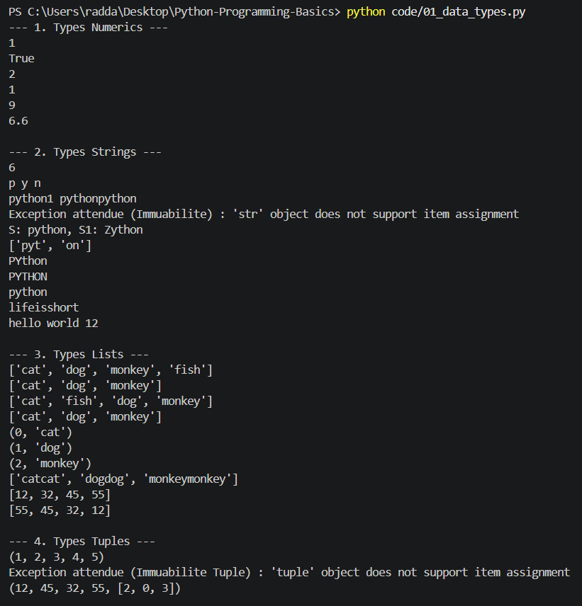
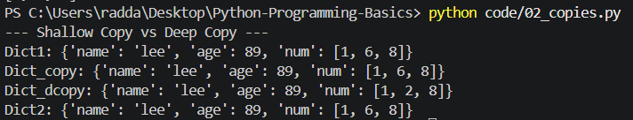
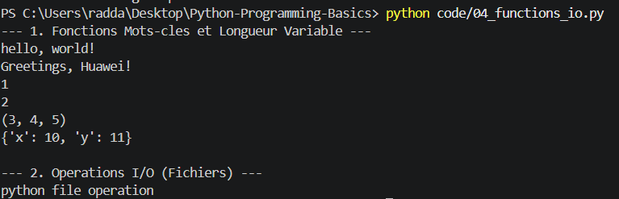

# Lab2 — Python Programming Basics

## 1. Introduction

### 1.1 Présentation du laboratoire
Ce laboratoire est extrait du guide officiel *HCIP-Datacom – Network Automation Developer Lab Guide*. Il est dédié à l'apprentissage et à la mise en pratique de la syntaxe fondamentale de Python 3 à travers des exercices ciblés.

### 1.2 Objectifs du laboratoire
Les objectifs principaux de ces manipulations sont :
- Maîtriser les types de données natifs (numériques, séquences, dictionnaires, ensembles).
- Assimiler la gestion de la mémoire via la différence entre copie superficielle et copie profonde.
- Manipuler les structures de contrôle algorithmiques (conditions et boucles).
- Concevoir des fonctions modulaires et réutilisables.
- Réaliser des opérations d'écriture et de lecture sur des fichiers.
- Implémenter des mécanismes robustes de gestion des exceptions.
- Mettre en œuvre les concepts fondamentaux de la programmation orientée objet (POO).

---

## 2. Environnement de travail

### 2.1 Outils utilisés
Contrairement aux recommandations du guide axées sur Jupyter Notebook via la suite Anaconda3, ce laboratoire a été entièrement réalisé sous l'environnement de développement **Visual Studio Code (VS Code)** en utilisant l'interpréteur natif **Python 3**.

### 2.2 Organisation du projet
Le projet respecte une architecture claire et modulaire pour dissocier le compte rendu du code source :
- `README.md` : Description générale du dépôt.
- `Lab2_Python_Programming_Basics.md` : Le présent compte rendu.
- `code/` : Dossier contenant les scripts Python (`.py`) développés pour chaque module.
- `images/` : Dossier regroupant les captures d'écran des résultats d'exécution.

---

## 3. Manipulation des Types de Données (Fichier : `01_data_types.py`)

Cette section regroupe l'étude des structures de données fondamentales de Python, exécutées au sein d'un unique script.

### 3.1 Code source implémenté
```python
# -*- coding: utf-8 -*-
# 1. Types Numériques
print("--- Numerics ---")
print(True + False)
print(True or False)
print(5 // 2)
print(5 % 2)
print(3 ** 2)
print(5 + 1.6)

# 2. Chaînes de caractères
print("\n--- Strings ---")
S = 'python'
print(len(S))
print(S[0], S[1], S[-1])
print(S + '1', S * 2)
try:
    S[0] = 'Z'
except TypeError as e:
    print(f"Erreur d'immutabilité : {e}")
S1 = 'Z' + S[1:]
print("S:%s, S1:%s" % (S, S1))
print(S.split('h'))
print(S.replace('py', 'PY'))
print(S.upper())
print('PYTHON'.lower())
print(''.join(['life', 'is', 'short']))

# 3. Listes
print("\n--- Lists ---")
animals = ['cat', 'dog', 'monkey']
animals.append('fish')
print(animals)
animals.remove('fish')
print(animals)
animals.insert(1, 'fish')
print(animals)
animals.pop(1)
print(animals)
for i in enumerate(animals):
    print(i)
squares = [x*2 for x in animals]
print(squares)
list1 = [12, 45, 32, 55]
list1.sort()
print(list1)
list1.reverse()
print(list1)

# 4. Tuples
print("\n--- Tuples ---")
T = (1, 2, 3)
print(T + (4, 5))
tuple1 = (12, 45, 32, 55, [1, 0, 3])
try:
    tuple1[0] = "good"
except TypeError as e:
    print(f"Erreur d'immutabilité Tuple : {e}")
tuple1[4][0] = 2
print(tuple1)

# 5. Dictionnaires
print("\n--- Dictionnaires ---")
x = {'food': 'Spam', 'quantity': 4, 'color': 'pink'}
d = x.copy()
d['color'] = 'red'
print(x)
print(d)
print(d.get('name', 'La clé n\'existe pas.'))
print(list(d.keys()))
print(list(d.values()))

# 6. Ensembles (Sets)
print("\n--- Sets ---")
sample_set = {'Prince', 'Techs'}
print('Data' in sample_set)
sample_set.add('Data')
print(sample_set)
list2 = [1, 3, 1, 5, 3]
print(list(set(list2)))
```

### 3.2 Résultats affichés et Interprétation
- **Numerics** : Les booléens agissent comme des entiers (`True` vaut 1, `False` vaut 0). L'opérateur `//` réalise une division entière et `**` gère les puissances.
- **Strings** : Les chaînes sont **immuables** ; modifier directement un index lève un `TypeError`. Le découpage (*slicing*) permet de générer de nouvelles chaînes.
- **Lists** : Les listes sont mutables. La compréhension de liste permet de générer des ensembles de données de manière concise et performante.
- **Tuples** : Le tuple lui-même est immuable, mais si l'un de ses éléments internes est une liste (mutable), le contenu de cette sous-liste peut être modifié en place.
- **Dictionnaires & Sets** : Le dictionnaire associe des clés uniques à des valeurs, tandis que le `set` élimine nativement tous les doublons d'une séquence.

**Capture d'écran de l'exécution :**


---

## 4. Copie superficielle vs Copie profonde (Fichier : `02_copies.py`)

Ce script met en évidence la gestion des adresses mémoires lors de la duplication de structures complexes ou imbriquées.

### 4.1 Code source implémenté
```python
# -*- coding: utf-8 -*-
import copy

print("--- Shallow Copy vs Deep Copy ---")
Dict1 = {'name': 'lee', 'age': 89, 'num':}
Dict_copy = Dict1.copy()          # Shallow copy
Dict_dcopy = copy.deepcopy(Dict1) # Deep copy
Dict2 = Dict1                     # Copie de référence directe

# Modification de la liste imbriquée dans l'objet original
Dict1['num'][1] = 6

print('Dict1:     ', Dict1)
print('Dict_copy: ', Dict_copy)
print('Dict_dcopy:', Dict_dcopy)
print('Dict2:     ', Dict2)
```

### 4.2 Résultats affichés et Interprétation
- **Dict2** (Simple référence) : Il pointe vers la même zone mémoire que `Dict1`, subissant toutes les modifications.
- **Dict_copy** (Copie superficielle) : Il duplique le dictionnaire parent mais réutilise les références des objets internes. La modification de la liste imbriquée apparaît donc également dans la copie.
- **Dict_dcopy** (Copie profonde) : Il recrée l'intégralité des objets parents et enfants de manière totalement isolée en mémoire. Ses données restent intactes et protégées.

**Capture d'écran de l'exécution :**


---

## 5. Structures de Contrôle Algorithmiques (Fichier : `03_control_structures.py`)

Ce module traite de la redirection des flux d'exécution via les conditions d'embranchement et les répétitions.

### 5.1 Code source implémenté
```python
# -*- coding: utf-8 -*-

# 1. Structure Conditionnelle (if) et Gestion d'Exceptions
print("--- Structure Conditionnelle & Try-Except ---")
def evaluer_score(score_input):
    try:
        score = float(score_input)
        if 100 >= score >= 90:
            print("Excellent")
        elif 90 > score >= 80:
            print("good")
        elif 80 > score >= 60:
            print("medium")
        elif 60 > score >= 0:
            print("bad")
        else:
            raise ValueError
    except Exception:
        print("Enter a correct score.")

evaluer_score("85")
evaluer_score("text_invalide")

# 2. Boucles For et While (Contrôle d'itération)
print("\n--- Boucles Multiplications et While ---")
for i in range(1, 4):
    for j in range(1, i + 1):
        print("%d * %d = %2d" % (i, j, i * j), end=" \t ")
    print()

print("\n--- Gestion break / continue ---")
i = 0
while i < 9:
    i += 1
    if i == 3:
        print("End the current loop.")
        continue
    if i == 5:
        print("End the current big loop.")
        break
    print(i)
```

### 5.2 Résultats affichés et Interprétation
- Le bloc `try-except` permet d'intercepter les erreurs d'entrée utilisateur (comme la conversion d'une chaîne alphabétique en nombre) sans planter le script.
- Dans les boucles, `continue` met fin prématurément à l'itération courante pour passer directement à la suivante, tandis que `break` interrompt définitivement l'ensemble de la boucle `while`.

**Capture d'écran de l'exécution :**


---

## 6. Fonctions et Entrées/Sorties I/O (Fichier : `04_functions_io.py`)

Ce script combine l'étude de la flexibilité des arguments au sein des fonctions et la gestion des flux de fichiers de texte.

### 6.1 Code source implémenté
```python
# -*- coding: utf-8 -*-

# 1. Paramètres de fonctions
print("--- Paramètres de fonctions ---")
def hello(greeting='hello', name='world'):
    print('%s, %s!' % (greeting, name))

hello()
hello('Greetings', name='Huawei')

def test(a, b, *c, **d):
    print(f"a: {a}, b: {b}, c (tuple): {c}, d (dict): {d}")

test(1, 2, 3, 4, 5, x=10, y=11)

# 2. Gestion de Fichiers avec Context Manager
print("\n--- Entrées / Sorties (I/O) ---")
with open("text1.txt", 'w') as f:
    f.write("python file operation")

with open("text1.txt", 'r') as f:
    print(f"Contenu lu : {f.read()}")
```

### 6.2 Résultats affichés et Interprétation
- Les arguments par défaut s'appliquent si aucune valeur n'est fournie. L'opérateur positionnel `*` rassemble les arguments excédentaires sous forme de tuple, tandis que le double opérateur `**` les mappe dans un dictionnaire.
- L'utilisation de l'instruction `with` (Context Manager) garantit une fermeture automatique et sécurisée du fichier, évitant l'usage manuel de `.close()`.

**Capture d'écran de l'exécution :**


---

## 7. Programmation Orientée Objet (Fichier : `05_oop.py`)

Ce dernier script met en application le paradigme objet à travers les concepts d'encapsulation, d'héritage et de polymorphisme.

### 7.1 Code source implémenté
```python
# -*- coding: utf-8 -*-

class Dog():
    def __init__(self, name, age):
        self.name = name
        self.__age = age  # Attribut privé (Encapsulation)
        
    def get_age(self):
        return self.__age
        
    def shout(self):
        print('Dog shouts')

class Husky(Dog):
    def shout(self):
        print('woo')

class Tibetan_Mastiff(Dog):
    def shout(self):
        print('barking')

def sound(dog):
    dog.shout()

# Instanciations et Polymorphisme
dog1 = Husky('Larry', 3)
dog2 = Dog('Richard', 2)
dog3 = Tibetan_Mastiff('Sylvia', 4)

print("--- Polymorphisme ---")
sound(dog1)
sound(dog2)
sound(dog3)

print("\n--- Encapsulation ---")
print(f"Nom du chien : {dog1.name}")
print(f"Âge (via méthode) : {dog1.get_age()}")

try:
    print(dog1.__age)
except AttributeError as e:
    print(f"Erreur attendue d'accès privé direct : {e}")
