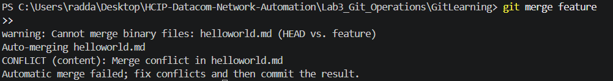

# Lab3 — Basic Git Operations

## 1. Introduction

### 1.1 Présentation du laboratoire
Ce laboratoire est extrait du guide officiel *HCIP-Datacom – Network Automation Developer Lab Guide* [1.1]. Il traite des concepts et des opérations de base du système de contrôle de version **Git** en utilisant l'interface de ligne de commande (CLI) [1.1].

### 1.2 Objectifs du laboratoire
À la fin de ce laboratoire, nous serons capables de :
- Créer et initialiser un dépôt Git local (*Local Repository*) [1.1].
- Enregistrer et valider les modifications (*Commit*) [1.1].
- Gérer les branches (Création, fusion et résolution de conflits) [1.1].
- Consulter l'historique des versions (*Git Log*) [1.1].

---

## 2. Environnement de travail

### 2.1 Outils utilisés
- **Git SCM** : L'outil de gestion de versions en ligne de commande [1.1].
- **Visual Studio Code (VS Code)** : Utilisé comme terminal pour l'exécution des commandes CLI et l'édition des fichiers textuels.

### 2.2 Configuration initiale de Git
Avant de commencer les manipulations, l'identité globale de l'utilisateur a été configurée dans le terminal via les commandes suivantes :
```bash
git config --global user.name "rahma-cyber"
git config --global user.email "votre.email@example.com"
```

---

## 3. Opérations Git via l'interface en ligne de commande (CLI)

### 3.1 Commandes exécutées
```bash
# 1. Création et initialisation du dépôt local
mkdir GitLearning
cd GitLearning
git init

# 2. Ajout d'un fichier et premier commit
echo "This is a Git repository." > readme.txt
git status
git add readme.txt
git commit -m "add readme.txt file"

# 3. Gestion des branches et fusion fluide (Fast-forward)
git branch feature
git switch feature
echo "hello world !" > helloworld.md
git add helloworld.md
git commit -m "add helloworld.md file"

git switch master
git merge feature

# 4. Création et résolution d'un conflit de fusion
# Modification simultanée sur la branche feature
git switch feature
echo "This is feature branch." >> helloworld.md
git add helloworld.md
git commit -m "Modify helloworld.md in feature branch."

# Modification simultanée sur la branche master
git switch master
echo "This is master branch." >> helloworld.md
git add helloworld.md
git commit -m "Modify helloworld.md in master branch."

# Tentative de fusion (Génère un CONFLIT)
git merge feature

# Résolution manuelle du fichier helloworld.md, puis validation
git add helloworld.md
git commit -m "Merge branch 'feature' and resolve conflict"
git log --pretty=oneline --graph
```

### 3.2 Analyse et Interprétation
- **`git init`** : Crée un sous-dossier caché `.git` qui sert de base de données pour suivre l'historique du projet.
- **`git add` & `git commit`** : Le fichier passe d'abord par la zone d'indexation (*Staging Area*) avant d'être validé définitivement dans le dépôt.
- **Résolution de conflit** : Lorsque le même fichier est modifié différemment dans deux branches au même endroit, Git bloque la fusion. Les balises `<<<<<<< HEAD`, `=======`, et `>>>>>>>` apparaissent, nous obligeant à nettoyer manuellement le fichier avant de valider le commit final de fusion.

**Capture d'écran de l'exécution CLI :**

